# PROD-K3S-V6 专属 GitOps 层级与独立发布

本方案只描述 V6。V5 的对象、版本和运行状态不参与本次调谐。
所有声明继续放在同一个 GitOps 仓库，但各发布单元独立固定配置版本和 chart/镜像版本。

## 1. 层级及职责

```mermaid
flowchart TD
  Repo[同一个 GitOps 仓库] --> Bootstrap[GitRepository: config-prod]
  Bootstrap --> Root[Kustomization: prod-k3s]
  Root --> NS[5 个服务 namespace + external-secrets]
  Root --> ESO[Kustomization: external-secrets]
  ESO --> EHR[HelmRelease: external-secrets 2.14.0]
  Root --> ID[Kustomization: vault-tls-identity]
  ID --> SA[ServiceAccount + scoped TokenRequest RBAC]
  ID -. dependsOn .-> ESO
  Root --> TLS[Kustomization: vault-tls-bootstrap]
  TLS -. dependsOn .-> ID
  TLS --> Ext[SecretStore + ExternalSecret]
  Ext --> TSecret[Secret: vault-prod/vault-server-tls]
  TLS -. dependsOn .-> ESO
  Root --> V[Vault 单元 GitRepository + 子 Kustomization]
  Root --> P[PostgreSQL 单元 GitRepository + 子 Kustomization]
  Root --> I[Ingress 单元 GitRepository + 子 Kustomization]
  Root --> O[Observability 单元 GitRepository + 子 Kustomization]
  Root --> W[Web SaaS 单元 GitRepository + 子 Kustomization]
  V -. dependsOn .-> TLS
  V --> VH[HelmRepository → HelmRelease: vault]
  P --> PH[同包 OCIRepository → HelmRelease: postgresql]
  I --> IH[同包 OCIRepository → HelmRelease: caddy-ingress]
  O --> OH[2 个 OCIRepository + HelmRepository → 3 个 HelmRelease]
  W --> WH[OCIRepository → HelmRelease: web-saas-prod]
```



根层管理 namespace、单元配置源、集群控制器前置与子 Kustomization 定义，不直接合并部署五套业务 chart。
服务资源由对应 HelmRelease 的 Helm controller 管理；不要让 root 或其他单元重复管理其 Deployment/Service/PVC。

| 层 | V6 对象 | 管理内容 | 更新边界 |
| --- | --- | --- | --- |
| 引导配置源 | `flux-system/config-prod` | V6 根目录的不可变配置 tag/commit | 仅 V6 管理图、单元 source pin 或放行状态变化时更新 |
| 根 Kustomization | `flux-system/prod-k3s` | `environments/clusters/prod-k3s-v6` | 根名按 GitOps 环境稳定；V6 批次路径隔离目录。冷启动先暂停；受审查的 `release-root` 阶段再启用管理根，`wait: false` 不等待暂停的子 Kustomization，不由 bootstrap 另外生成 `platform-root` |
| 单元配置源 | 5 个 `flux-system/<unit>-config` | 同仓库中该单元配置的独立 tag/commit | 只推进被选中单元；其他四个 pin 保留 |
| 子 Kustomization | 5 个 `flux-system/<unit>` | `services/prod-k3s-v6/<unit>` | 独立 sourceRef、path、暂停状态、健康等待及最小依赖 |
| 控制器前置 | `flux-system/external-secrets` | `services/prod-k3s-v6/cluster-prerequisites/external-secrets` | ESO 2.14.0、CRD 与控制器；不属于五个业务发布单元 |
| Vault TLS 身份 Kustomization | `flux-system/vault-tls-identity` | `services/prod-k3s-v6/vault-prod/tls-identity` | 仅创建读取身份和范围限定的 TokenRequest 授权，供 Vault 身份验收 |
| Vault TLS 引导 Kustomization | `flux-system/vault-tls-bootstrap` | `services/prod-k3s-v6/vault-prod/tls-bootstrap` | 读取现有公共 Vault 域名证书，并在 Vault chart 前生成 TLS Secret |
| Chart 源 | 各服务 namespace 的 HelmRepository/OCIRepository | chart 来源及固定版本/digest | chart 源与配置 GitRepository 是两个不同层次 |
| HelmRelease | 各服务 namespace | chart values、chartRef、运行版本及 release 生命周期 | 可以独立固定版本；受 UI/API/DB 升级规则约束 |

V6 首次图为 **6 个 GitRepository、1 个根 + 5 个业务单元 + 3 个前置 Flux Kustomization、8 个 HelmRelease**。
其中七个 HelmRelease 属于五个业务单元，新增的 ESO HelmRelease 是集群控制器前置。
观测单元含三个独立发布的 chart，因此“五单元”不强制合并为“五个 HelmRelease”。

## 2. 五个发布单元的精确对应

| 发布单元 / namespace / 子 Kustomization | 独立 GitRepository（flux-system） | HelmRelease（服务 namespace） | 管理范围 |
| --- | --- | --- | --- |
| `vault-prod` | `vault-prod-config` | `vault` | V6 Vault、Raft PVC、Vault 自身身份配置；TLS/恢复材料按外部可信引导路径提供 |
| `postgresql-prod` | `postgresql-prod-config` | `postgresql` | PostgreSQL、ClusterIP Service、PVC、数据库运行配置；应用 schema/数据迁移由 owner 工具执行 |
| `ingress-prod` | `ingress-prod-config` | `caddy-ingress` | Caddy 反向代理、TLS 引用及 V6 路由；与 DB/业务使用同一个 chart 包，TLS Secret 在入口 namespace |
| `observability-prod` | `observability-prod-config` | `observability`、`observability-agent`、`datakit` | 监控存储/查询/Dashboard/探测、采集器；不承载业务账单状态 |
| `web-saas-prod` | `web-saas-prod-config` | `web-saas-prod`（releaseName `web-saas`） | UI/API Deployment、Service、应用配置；内嵌 PostgreSQL 和 Caddy 关闭 |

Web SaaS 当前采用一个已有 fullstack chart，单元级发布会调谐该 HelmRelease；UI/API 子服务
不是额外的 Flux 发布单元。将来要分别发布 UI/API chart，需要 producer/consumer 契约变更，
不能在本轮规划中声称已经具备每个 Deployment 的独立 HelmRelease。

PostgreSQL、`caddy-ingress`、`web-saas-prod` 三个 HelmRelease 统一引用同一个
`distributed-web-saas-fullstack` OCI chart 包，在各自 namespace 保留独立 source/digest。
通过 PostgreSQL-only、Caddy-only、application-only 三套 values 控制资源归属；Caddy 使用
显式跨 namespace 后端，不重复启用业务 Pod。独立 Caddy 契约仍待 producer 发布新 digest，
旧暂停 pin 不构成可部署证据。完整 values 和 KV 路径关联见创建准备文档。

## 2.1 V6 域名分配与入口边界

以下是 V6 专属主机名，不代表 DNS 已创建或服务已经可访问。V5 canonical 域名保持不变；
用户要求 V6 专属域名最终解析到新集群。先用 `curl --resolve <host>:443:<V6-IP>` 完成无 DNS
路由检查，取得实际节点地址后新增 V6 记录。V6 证书需覆盖对应 SAN，且须核对证书/私钥匹配、有效期和链；
不得因域名已写入配置而推定证书或 DNS 有效。

Selfhost V6 继续使用 `dns_mode=none`，其作用是禁止默认更新 canonical 域名，不代表禁止
V6 批次专属记录。六个 V6 名称需走独立 DNS owner 操作；当前 Selfhost Orchestrator 没有此 A
记录写入阶段。初步按 DNS-only A、TTL 60 秒指向 CMDB 核实的 V6 IPv4 规划；不创建 AAAA，除非
实际分配并验收 IPv6。该记录操作不得改写 `vault.svc.plus`、`observability.svc.plus`、
`console.svc.plus`、`accounts.svc.plus`、`billing.svc.plus` 或 `postgresql.svc.plus`。

| 服务 | 建议的 V6 域名/访问方式 | 当前声明中的候选名 | 入口与凭据规划 | 状态/门禁 |
| --- | --- | --- | --- | --- |
| Console UI | `console-selfhost-prod-v6.svc.plus` | `console-k3s-v6.svc.plus`（旧候选，已改为推荐名） | Caddy → `web-saas-console.web-saas-prod.svc.cluster.local:80`；`ingress-prod/console-tls` | 名称已按 V5 结构收敛；待证书 SAN、TLS KV 和 HTTPS/页面验收 |
| Accounts API/UI | `accounts-selfhost-prod-v6.svc.plus` | `accounts-k3s-v6.svc.plus`（旧候选，已改为推荐名） | Caddy → `web-saas-accounts.web-saas-prod.svc.cluster.local:80`；`ingress-prod/accounts-tls` | 名称已按 V5 结构收敛；待证书 SAN、TLS KV、接口回归和错误率验收 |
| Billing API/UI | `billing-selfhost-prod-v6.svc.plus` | `billing-k3s-v6.svc.plus`（旧候选，已改为推荐名） | Caddy → `web-saas-billing.web-saas-prod.svc.cluster.local:80`；`ingress-prod/billing-tls` | 名称已按 V5 结构收敛；真实扣款/退款及 webhook 另行评审，不因 V6 路由自动启用 |
| PostgreSQL | `postgresql-selfhost-prod-v6.svc.plus`（DNS 名称已分配；不开放公网 DB 端口） | 待新增 V6 A 记录 | 应用走集群内 Service DNS；`migratectl` 按迁移授权访问隔离的目标库 | DNS 解析与数据库网络访问分离；5432 不加入公网防火墙 |
| Content | 暂不分配独立公网域名 | `content-k3s-v6.svc.plus` | 优先作为业务内部服务，由 Console/API 内部访问；当前 Caddy 无对应 route/TLS 引用 | 待业务 owner 确认独立外部入口、后端 Service/端口及认证后再分配 |
| Observability | `observability-k3s-v6.svc.plus` | 同左，Grafana `rootUrl` 当前已使用 | DNS 只解析到 V6 节点；访问仍须经 VPN/受限运维通道，当前 Caddy 无 route/TLS 引用 | DNS 生效不等于公开访问放行；先确认 SSO、来源限制和 TLS |
| Vault | `vault-selfhost-prod-v6.svc.plus`（V6 专属服务/TLS 名称；不公开管理/API） | `vault-k3s-v6.svc.plus`（旧候选，已改为推荐名） | 不通过 Caddy 对公网暴露 Vault 管理/API；初始证书读取仍走现有 `https://vault.svc.plus` | 待证书 SAN、Vault `tlsServerName` 与集群内服务名核对；公共 Vault 域名/DNS保持不变 |

初始化 Vault TLS 所读取的来源仍为现有公共 `https://vault.svc.plus`，它只用于读取受控
证书记录，不等于 V6 Vault 的服务地址。V6 上述候选名的
用户提供的 V5 记录显示：`console-selfhost-prod-v5.svc.plus` 曾有 Google DoH A 记录回执
（TTL 60、status 0），但 HTTPS/SNI、登录和 runtime 为 `NOT_RUN`；Accounts/Billing 仅有
provider 确认，独立查询仍待补，PostgreSQL 项无结果。以上均不是 V6 可用性证据，也不构成
V5 线上验收。V6 建议域名的本机递归查询未返回记录；Google DoH A 查询对 Console、Accounts、
Billing、PostgreSQL、Vault、Observability 的 V6 名称均返回 NXDOMAIN。V6 GitOps 路由与
`service_domains` 已按确认的名称收敛；用户要求的 V6 DNS 记录尚未创建，须待本批次实际地址
核实后添加；V5 canonical 域名不变。发布前仍须核对证书 SAN、KV 记录和验收清单。

### 与 V5 基线相同格式的 V6 批次验收清单

| V5 基线 | V6 批次建议域名 | V6 DNS/入口状态 | HTTPS/SNI、应用或数据库验收 |
| --- | --- | --- | --- |
| `console-selfhost-prod-v5.svc.plus`：Google DoH A 有早期回执；页面/runtime `NOT_RUN` | `console-selfhost-prod-v6.svc.plus` | Google DoH A 查询返回 NXDOMAIN；未创建记录 | HTTPS/SNI、登录、关键页面和 runtime 均 `NOT_RUN` |
| `accounts-selfhost-prod-v5.svc.plus`：provider 已确认，独立查询待补 | `accounts-selfhost-prod-v6.svc.plus` | Google DoH A 查询返回 NXDOMAIN；未创建记录 | HTTPS/SNI、API 回归、错误率和 runtime 均 `NOT_RUN` |
| `billing-selfhost-prod-v5.svc.plus`：provider 已确认，独立查询待补 | `billing-selfhost-prod-v6.svc.plus` | Google DoH A 查询返回 NXDOMAIN；未创建记录 | HTTPS/SNI、webhook 和 runtime 均 `NOT_RUN`；真实交易未授权 |
| `postgresql-selfhost-prod-v5.svc.plus`：无记录证据 | `postgresql-selfhost-prod-v6.svc.plus` | Google DoH A 查询为 NXDOMAIN；地址确认后需解析到 V6 节点，但 5432 保持关闭 | 数据库仅集群内访问；部署后验证 Service、PVC、备份恢复和授权的迁移连接 |

同一命名批次下，`content` 暂不分配域名；`observability-k3s-v6.svc.plus` 与
`vault-selfhost-prod-v6.svc.plus` 也需解析到 V6 新节点，但不因此开放匿名监控或 Vault 管理/API。
初步规划为 6 条 DNS-only A 记录、TTL 60 秒，目标为实际 IaC/CMDB 确认的 V6 IPv4；不配置 AAAA
除非确认 IPv6 地址。新增前检查 Cloudflare 权威区冲突和代理模式。建议名的 DoH 结果只代表本次 A 查询
得到 NXDOMAIN，后续正式启用前仍须检查 A/AAAA/CNAME、权威区、解析目标、TLS SAN/链和
HTTPS/SNI；DNS 生效后再独立验证实际路由和服务。PostgreSQL 5432 防火墙仍保持关闭。

## 3. 每种版本与更新方式

- **根配置版本**：`config-prod.spec.ref`。保存 V6 管理图与各单元的选择。
- **单元配置版本**：`<unit>-config.spec.ref`。固定该单元的 values、chartRef、暂停状态等；
  五个配置源可处于不同不可变 tag，不要求同时升级。
- **Chart 版本**：HelmRepository 模式使用 HelmRelease 的精确 `chart.spec.version`；
  OCI 模式固定 OCIRepository digest/精确 tag，HelmRelease 使用 `chartRef`。
- **镜像版本**：按 chart 契约固定 image digest 或已审查的不可变 tag；chart 版本不自动证明镜像已固定。

例如只修复 Web SaaS API：

1. 仅修改 `services/prod-k3s-v6/web-saas-prod` 的相应镜像/chart 配置，审查并发布包含该修改的稳定 tag。
2. 在新的根配置提交中只推进 `web-saas-prod-config` 的 tag，再审查发布根配置版本。
3. 由授权入口将 V6 根 source 指向这个新管理图版本。其他四个单元配置 tag 保持原值，
   各自 chart/镜像版本不变化；根 source 变更不等于全部单元升级。
4. 已放行的 Web SaaS 子 Kustomization 和 HelmRelease 各自调谐。验收接口、回归和错误率。

独立更新是“独立选择版本和调谐范围”，不等于无依赖、无审查或允许修改业务持久状态。
SQL schema/数据库/业务持久状态版本转换必须去下一代新集群；这类 source/HR pin 不能在 V6
原地推进。独立非业务/非账单监控服务可按已明确的例外原地更新。

## 4. 引导、暂停与放行

### 首次引导

冷启动时六个 GitRepository 固定到同一完整管理图的已审查 tag，便于从单一 commit
核对完整初始图。后续五个单元 GitRepository 可独立固定和推进不可变 tag；根管理 source
仍单独固定根配置 tag，不重新执行首次全图引导。

Playbooks 的 `declarative_paused` 模式从控制端固定 GitOps checkout 校验并加载管理图，
不会另外生成/调谐 `platform-root`。首次加载时六个 GitRepository、根与八个子 Kustomization、
八个 HelmRelease 全部暂停；后续受审查的 `release-root` 操作只启用 `config-prod` 和根 `prod-k3s`，
五个单元 source 与八个子 Kustomization/HelmRelease 继续保持暂停。ExternalSecret 本身没有 `suspend` 字段；
它由暂停的 `vault-tls-bootstrap` Kustomization 隔离，不会在放行前调谐。
所有对象已加载不等于 release 已安装，更不等于业务健康或数据验收通过。

引导器验证根配置 tag、首发统一 source pin、对象名称、sourceRef/path、一单元一配置源及完整暂停边界；
若发现已有 active Flux 对象则拒绝冷启动覆盖。保留旧 generated 模式仅为既有 caller 兼容，
V6 明确选声明式分阶段模式。

### 放行顺序

1. K3s 与 Flux core 由受审查的 Playbooks bootstrap 安装。V6 已验收 K3s `v1.37.1+k3s1` Ready，
   Flux source/kustomize/helm/notification controller 均 `1/1 Ready`；不重复安装。
2. 节点、独立数据卷 `/data`、PV 供给路径、hostname/身份及完整暂停式 Flux 声明加载完成。
   经 `release-root` 审查后只启用管理 source/root；root `wait: false` 只确认管理对象成功应用，
   五个业务单元和三个前置子 Kustomization/HelmRelease 仍保持暂停。
3. 单独放行 `external-secrets` Kustomization 与 HelmRelease，等待 ESO controller 和 CRD Ready。
   ESO 固定 Helm chart `2.14.0`；V6 K3s `1.37` 在该版本上游支持矩阵内。禁用 chart 默认的全局
   `serviceaccounts/token` 创建权限，只授予 ESO 对 `vault-prod/vault-tls-reader` 的命名空间级、
   resourceName 限定 TokenRequest 权限。
4. 放行 `vault-tls-identity`，创建专用 ServiceAccount 与限定 TokenRequest 权限；保持 `vault-tls-bootstrap` 暂停。
   由共享公共 Vault 的 owner 配置独立 JWT auth mount/role：只接受
   V6 专用 service account、专用 audience，并仅能读取 `kv/data/CICD/domains/svc.plus`。
   Vault JWT verifier 必须信任 V6 K3s service-account 签名公钥与 issuer；不开放公网 K3s API 供
   Vault TokenReview，也不存静态 Vault token。使用真实 ServiceAccount 验证指定记录可读、相邻记录被拒绝、
   错误 audience 和错误 ServiceAccount 登录被拒绝，记录脱敏证据。此角色与 V6 Vault 启动后的内部 Vault auth 完全分开。
   Flux dependsOn 仅验证身份对象已应用；授权验收是独立的放行门禁，不由 dependsOn 自动证明。
5. 放行 `vault-tls-bootstrap` 后等待其 ExternalSecret `Ready=True`，检查目标 Secret 名称/类型、证书
   与私钥匹配、有效期及 SAN `vault-selfhost-prod-v6.svc.plus`；敏感值不得写入日志。ExternalSecret 每 5 分钟读取公共 Vault 中
   `tls_fullchain_pem_b64` / `tls_key_pem_b64`，解码后生成 `vault-prod/vault-server-tls`。
   公网 Vault 地址仍是 `https://vault.svc.plus`；不改 DNS、不本机签发证书。
6. 只有 Secret 同步与证书校验通过后，才放行 Vault 子 Kustomization/HelmRelease；之后由 Vault owner
   独立执行初始化、unseal、恢复材料保管及 V6 内部 auth 准备。不可让尚未初始化的 V6 Vault
   为自身 TLS 或首次凭据提供来源。
7. Vault Ready 并且内部 ESO/SecretStore 可用后，按 PostgreSQL、Observability 的顺序各自放行；
   Web SaaS 等 Vault 与 PostgreSQL。数据迁移前目标业务写者/后台任务保持暂停。
8. Ingress 按用户要求最后放行，并依赖 Vault、Observability、Web SaaS。先用 V6 专属域名做受控
   路由和 TLS 验证；公共 DNS 变更保持为单独、后续评审步骤。
9. 所有暂停变更必须在权威固定版本声明中：根配置管理 source/Kustomization 放行，单元 tag 管
   HelmRelease 状态。不能只现场 `flux resume` 后让父层旧声明再次暂停。

不要在 HelmRelease 暂停时等待子 Kustomization 健康成功再决定是否放行 HelmRelease；
`wait: true` 会等待其 release 健康，需按同一单元的放行步骤配套推进后再观察 Ready。
逐层解除暂停不授予数据库迁移、真实扣退款、DNS 或写入权切换权限。

## 5. 依赖、健康及数据保护

`dependsOn` 编码会导致 reconcile 失败或不可用的硬前置；人工/数据验收仍是额外门禁：

- `external-secrets` Kustomization 安装 ESO chart/CRD；`vault-tls-identity` dependsOn ESO；`vault-tls-bootstrap` dependsOn 两者。
- Vault 子 Kustomization dependsOn `vault-tls-bootstrap`；TLS ExternalSecret Ready 是 Vault HelmRelease 的硬门禁。
- PostgreSQL 和 Observability 分别依赖 Vault；首次部署按 PostgreSQL、Observability 顺序放行。
- Web SaaS 依赖 Vault 与 PostgreSQL；它不依赖独立监控或 Ingress。
- Ingress 依赖 Vault、Observability 与 Web SaaS，依照部署安排最后放行；公网 DNS 仍单独评审。
- 依赖状态 Ready 不代替证书 SAN/有效期、应用链路、PVC/备份恢复和业务验收。

根和包含数据的子 Kustomization 使用 `prune: false`，减少移除定义时级联删除的风险；
这不禁止 Helm 升级自身删除资源，也不代替 PVC/StorageClass `Retain`、云卷删除保护、
备份与恢复演练。任何 release uninstall、namespace/PVC 删除和旧代退役单独评审授权。

## 6. 文件布局与当前交付边界

```text
environments/clusters/prod-k3s-v6/
  kustomization.yaml              # 根目录资源列表，也包含 root.yaml
  source.yaml                     # 引导 GitRepository
  root.yaml                       # 唯一 V6 根 Flux Kustomization
  unit-sources.yaml               # 五个独立单元配置源
  external-secrets-kustomization.yaml
  vault-tls-identity-kustomization.yaml
  vault-tls-bootstrap-kustomization.yaml
  namespaces.yaml
  platform-*-kustomization.yaml    # 四个平台子单元
  web-saas-kustomization.yaml
services/prod-k3s-v6/cluster-prerequisites/external-secrets/ # ESO chart/controller
services/prod-k3s-v6/vault-prod/tls-identity/ # 仅 SA 和 TokenRequest RBAC
services/prod-k3s-v6/vault-prod/tls-bootstrap/ # 公共 Vault → ESO → vault-server-tls
services/prod-k3s-v6/<unit>/       # 五个业务单元自己的 Kustomize、chart source、HelmRelease
```

V6 已安装并验收 K3s `v1.37.1+k3s1` 及四个 Flux controller；ESO 与 TLS bootstrap 声明是本次新增，
仍需使用新 GitOps tag、由受审查入口完整暂停加载，再按上述依赖逐级放行。详见[创建准备与实机证据](prod-k3s-v6-node-cluster-preflight.md)。
