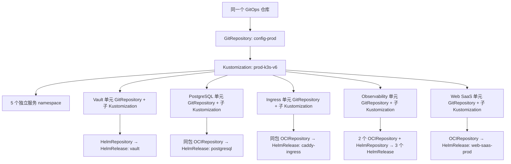

# PROD-K3S-V6 专属 GitOps 层级与独立发布

本方案只描述 V6。V5 的对象、版本和运行状态不参与本次调谐。
所有声明继续放在同一个 GitOps 仓库，但各发布单元独立固定配置版本和 chart/镜像版本。

## 1. 层级及职责



根层只管理 namespace、单元配置源及子 Kustomization 定义，不直接合并部署五套 chart。
服务资源由对应 HelmRelease 的 Helm controller 管理；不要让 root 或其他单元重复管理其 Deployment/Service/PVC。

| 层 | V6 对象 | 管理内容 | 更新边界 |
| --- | --- | --- | --- |
| 引导配置源 | `flux-system/config-prod` | V6 根目录的不可变配置 tag/commit | 仅 V6 管理图、单元 source pin 或放行状态变化时更新 |
| 根 Kustomization | `flux-system/prod-k3s-v6` | `environments/clusters/prod-k3s-v6` | 不由 bootstrap 另外生成 `platform-root`；根对象自身也在该目录声明 |
| 单元配置源 | 5 个 `flux-system/<unit>-config` | 同仓库中该单元配置的独立 tag/commit | 只推进被选中单元；其他四个 pin 保留 |
| 子 Kustomization | 5 个 `flux-system/<unit>` | `services/prod-k3s-v6/<unit>` | 独立 sourceRef、path、暂停状态、健康等待及最小依赖 |
| Chart 源 | 各服务 namespace 的 HelmRepository/OCIRepository | chart 来源及固定版本/digest | chart 源与配置 GitRepository 是两个不同层次 |
| HelmRelease | 各服务 namespace | chart values、chartRef、运行版本及 release 生命周期 | 可以独立固定版本；受 UI/API/DB 升级规则约束 |

结果是 **6 个 GitRepository、1 个根 + 5 个子 Flux Kustomization、7 个 HelmRelease**。
观测单元含三个独立发布的 chart，因此“五单元”不强制合并为“五个 HelmRelease”。

## 2. 五个发布单元的精确对应

| 发布单元 / namespace / 子 Kustomization | 独立 GitRepository（flux-system） | HelmRelease（服务 namespace） | 管理范围 |
| --- | --- | --- | --- |
| `vault-prod` | `vault-prod-config` | `vault` | V6 Vault、Raft PVC、Vault 自身身份配置；TLS/恢复材料按外部可信引导路径提供 |
| `postgresql-prod` | `postgresql-prod-config` | `postgresql` | PostgreSQL、ClusterIP Service、PVC、数据库运行配置；应用 schema/数据迁移由 owner 工具执行 |
| `ingress-prod` | `ingress-prod-config` | `caddy-ingress` | Caddy 反向代理、TLS 引用及 V6 路由；与 DB/业务使用同一个 chart 包，TLS Secret 在入口 namespace |
| `observability-prod` | `observability-prod-config` | `observability`、`observability-agent`、`datakit` | 监控存储/查询/Dashboard/探测、采集器；不承载业务账单状态 |
| `web-saas-prod` | `web-saas-prod-config` | `web-saas-prod`（releaseName `web-saas`） | UI/API Deployment、Service、应用配置；内嵌 PostgreSQL 和 Caddy 关闭 |

Web SaaS 当前采用一个已有 fullstack chart，单元级发布会调谐该 HelmRelease；UI/API 子服务
不是额外的 Flux 发布单元。将来要分别发布 UI/API chart，需要 producer/consumer 契约变更，
不能在本轮规划中声称已经具备每个 Deployment 的独立 HelmRelease。

PostgreSQL、`caddy-ingress`、`web-saas-prod` 三个 HelmRelease 统一引用同一个
`distributed-web-saas-fullstack` OCI chart 包，在各自 namespace 保留独立 source/digest。
通过 PostgreSQL-only、Caddy-only、application-only 三套 values 控制资源归属；Caddy 使用
显式跨 namespace 后端，不重复启用业务 Pod。独立 Caddy 契约仍待 producer 发布新 digest，
旧暂停 pin 不构成可部署证据。完整 values 和 KV 路径关联见创建准备文档。

## 3. 每种版本与更新方式

- **根配置版本**：`config-prod.spec.ref`。保存 V6 管理图与各单元的选择。
- **单元配置版本**：`<unit>-config.spec.ref`。固定该单元的 values、chartRef、暂停状态等；
  五个配置源可处于不同不可变 tag，不要求同时升级。
- **Chart 版本**：HelmRepository 模式使用 HelmRelease 的精确 `chart.spec.version`；
  OCI 模式固定 OCIRepository digest/精确 tag，HelmRelease 使用 `chartRef`。
- **镜像版本**：按 chart 契约固定 image digest 或已审查的不可变 tag；chart 版本不自动证明镜像已固定。

例如只修复 Web SaaS API：

1. 仅修改 `services/prod-k3s-v6/web-saas-prod` 的相应镜像/chart 配置，审查并发布包含该修改的稳定 tag。
2. 在新的根配置提交中只推进 `web-saas-prod-config` 的 tag，再审查发布根配置版本。
3. 由授权入口将 V6 根 source 指向这个新管理图版本。其他四个单元配置 tag 保持原值，
   各自 chart/镜像版本不变化；根 source 变更不等于全部单元升级。
4. 已放行的 Web SaaS 子 Kustomization 和 HelmRelease 各自调谐。验收接口、回归和错误率。

独立更新是“独立选择版本和调谐范围”，不等于无依赖、无审查或允许修改业务持久状态。
SQL schema/数据库/业务持久状态版本转换必须去下一代新集群；这类 source/HR pin 不能在 V6
原地推进。独立非业务/非账单监控服务可按已明确的例外原地更新。

## 4. 引导、暂停与放行

### 首次引导

首次候选的六个 GitRepository pin 指向同一个包含完整 V6 目录的已审查 tag/commit，
便于核对完整初始图。当前文件中的旧 `v2026.10.29.3` 只是暂停占位，尚不含 V6 目录，
不能用于实际 bootstrap。选定正式候选时必须替换全部初始 pin 并验证解析结果。

Playbooks 的 `declarative_paused` 模式从控制端固定 GitOps checkout 构建 root 与五个子路径，
加载 source、root、子 Kustomization、chart 源及 HelmRelease；不会另外生成/调谐 `platform-root`。
六个 GitRepository、六个 Flux Kustomization 和七个 HelmRelease 均要求 `suspend: true`。
所有对象已加载不等于 release 已安装，更不等于业务健康或数据验收通过。

引导器验证源码 commit、稳定 tag、对象名称、sourceRef/path、一单元一配置源以及完整暂停状态；
拒绝覆盖已有 active Flux 图。保留旧 generated 模式仅为既有 caller 兼容，V6 明确选 paused 模式。

### 放行顺序

1. 节点、独立数据卷 `/data`、PV 供给路径、身份、控制器和基础 Secret 前置完成。
2. 在权威声明中启用根 GitRepository 和根 Kustomization，仅使管理图开始调谐。
   单元 source、子 Kustomization、HelmRelease 仍保持暂停，不随根一起批量启用。
3. 按 Vault → PostgreSQL → Ingress → Observability → Web SaaS 的冷启动验收顺序，
   对每个被选单元分别启用其 GitRepository、子 Kustomization，再启用相应 HelmRelease。
   数据迁移前目标业务写者/后台任务保持暂停。
4. 声明变更必须位于对应层的固定版本中：root 管 unit source/Kustomization 的放行，
   unit 配置 tag 管 HelmRelease 放行。不能只现场 `flux resume` 后让父层旧声明再次暂停。

不要在 HelmRelease 暂停时等待子 Kustomization 健康成功再决定是否放行 HelmRelease；
`wait: true` 会等待其 release 健康，需按同一单元的放行步骤配套推进后再观察 Ready。
逐层解除暂停不授予数据库迁移、真实扣退款、DNS 或写入权切换权限。

## 5. 依赖、健康及数据保护

`dependsOn` 只表示真正的发布前置，不把人工验收顺序全部编码为依赖：

- Vault 没有单元依赖，TLS/初始化/unseal 前置由引导 owner 完成。
- PostgreSQL、Ingress、Observability 依赖 Vault 提供的相应 Secret/身份准备。
- Web SaaS 依赖 Vault 和 PostgreSQL；不因独立监控或 Ingress 的单独维护强制阻断应用发布。
  业务对外验收仍必须同时检查入口和观测链路。
- chart 内部及 CRD/ESO/Secret 依赖需按实际渲染资源验证，不能仅靠 Flux Ready 证明。

根和包含数据的子 Kustomization 使用 `prune: false`，减少移除定义时级联删除的风险；
这不禁止 Helm 升级自身删除资源，也不代替 PVC/StorageClass `Retain`、云卷删除保护、
备份与恢复演练。任何 release uninstall、namespace/PVC 删除和旧代退役单独评审授权。

## 6. 文件布局与当前交付边界

```text
environments/clusters/prod-k3s-v6/
  kustomization.yaml              # 根目录资源列表，也包含 root.yaml
  source.yaml                     # 引导 GitRepository
  root.yaml                       # 唯一 V6 根 Flux Kustomization
  unit-sources.yaml               # 五个独立单元配置源
  namespaces.yaml
  platform-*-kustomization.yaml    # 四个平台子单元
  web-saas-kustomization.yaml
services/prod-k3s-v6/<unit>/       # 各单元自己的 Kustomize、chart source、HelmRelease
```

这套声明需要与固定版本的 Playbooks paused bootstrap 配套使用。代码/离线构建通过仅证明
声明图及引导契约，不代表云节点已创建、引导已执行、chart 已验收或数据已迁移。
