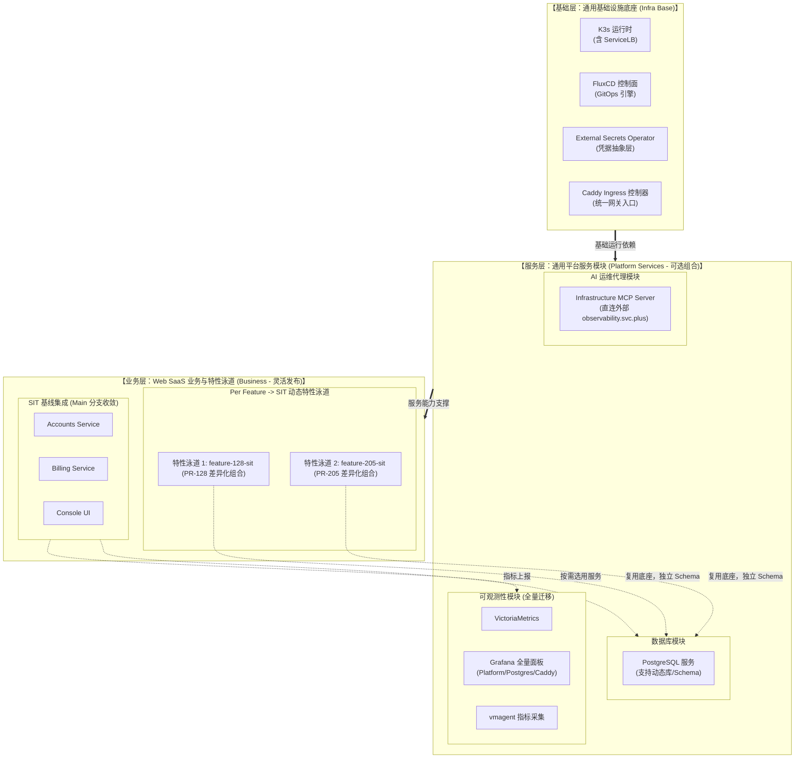

# SIT 开发测试环境架构与部署规划方案
## 生产与测试环境 基础、服务、业务全面模块化与灵活可组合规范

> **核心原则**：**分层解耦、服务模块化、乐高式灵活组合（Composable Modular Architecture）**。  
> 生产环境（`prod-k3s-v6`）与测试环境（`sit-k3s-v6`）不再维护相互割裂的死板配置，而是抽象出标准化的**基础模块（Base Infra）**、**平台服务模块（Platform Services）**与**业务模块（Business Workloads）**。通过声明式 GitOps 编排与环境变量/Values 补丁，实现不同环境的灵活装配与按需裁剪；在保障生产零触碰的前提下，一键拉起 SIT 环境，并原生赋能 **Per Feature $\rightarrow$ SIT 业务特性发布流**。  
> **目标主机**：`ssh root@172.237.9.58`（Ubuntu 26.10, 2 vCPU / 4 GB RAM / 80 GB SSD）  
> **交付模式**：Playbook 节点底座引导（不依赖 GitHub Actions） + GitOps (FluxCD) 声明式模块装配。

---

## 1. 三层模块化与可组合模型 (Three-Tier Composable Model)

系统被正交分解为三个独立演进、按需插拔的层次：



---

## 2. 模块能力与灵活组合矩阵

通过模块化设计，各个模块在不同环境中通过**开关（Feature Flags）与声明式 Overlay**灵活组装：

| 模块类别 | 模块名称 | 生产环境 (PROD) 组合策略 | 测试环境 (SIT) 组合策略 | 组合配置与解耦机制 |
| :--- | :--- | :--- | :--- | :--- |
| **基础层** | **K3s + ServiceLB** | 必选，禁用公网控制面 | 必选，ServiceLB 监听 80/443 | 统一 Playbook 初始化，通过主机变量调整监听策略 |
| **基础层** | **FluxCD 控制面** | 必选，跟踪 `prod-k3s-v6` 根 | 必选，跟踪 `sit-k3s-v6` 根 | 独立的 GitRepository / 根 Kustomization，彻底物理隔离 |
| **基础层** | **ESO (External Secrets)** | 必选，对接生产独立 Vault 集群 | 必选，对接本地 Local SecretStore | **上层工作负载通过标准 ExternalSecret 消费凭据，代码 100% 相同** |
| **基础层** | **Caddy Ingress** | 必选，加载生产生产级 TLS 证书 | 必选，接入 `*.sit.onwalk.net` | 统一的 Caddy Ingress Controller，域名通过 Values 注入 |
| **服务层** | **PostgreSQL** | 必选，挂载生产 100GB 云卷 | 必选，挂载本地 5GB 快速 PVC | 同一 Chart，SIT 环境支持自动初始化多个特性 Database |
| **服务层** | **Observability 全栈** | 必选，生产指标长期归档 | **必选，全量迁移生产全部 Grafana 面板** | **Dashboard ConfigMaps 100% 共享**，为未来接管 `observability.svc.plus` 准备 |
| **服务层** | **Infrastructure MCP** | 可选，生产权限限制 | **必选，直连外部 `observability.svc.plus`** | 仅通过环境变量配置 `GRAFANA_URL` 指向外部权威源 |
| **业务层** | **Web SaaS (基线)** | 必选，严格主干验证版本 | 必选，常驻集成验证基线 | 包含 Accounts、Billing、Console 标准三件套 |
| **业务层** | **Feature SIT 泳道** | 严禁生产直接运行 | **按需动态组合**（由 PR 触发/销毁） | 支持单服务替换或全量特性沙箱组合 |

---

## 3. 灵活组合实战：Per Feature $\rightarrow$ SIT 业务流

当开发者提交 PR 或需要多仓库联调时，无需重复搭建数据库、监控或网关底座，利用模块化组合实现秒级创建：

```text
【组合示例：PR-128 特性验证】
1. 共享基础：继承 Shared SIT 的 K3s、Flux、ESO、Caddy Ingress
2. 共享服务：继承 Shared SIT 的 Observability (自动采集泳道指标)
3. 隔离存储：在 postgresql-sit 中动态分配独立数据库 account_pr128
4. 业务组合：
   - Accounts: 使用 PR-128 候选镜像 (ghcr.io/ai-workspace/accounts:pr-128)
   - Billing:  复用 SIT 基线镜像 (稳定版本)
   - Console:  复用 SIT 基线镜像 (稳定版本)
5. 路由暴露：自动绑定 http://feat-128.sit.onwalk.net
```
验证完成后，直接删除该 Feature Kustomization 声明，命名空间与计算资源自动释放，实现资源极致复用。

---

## 4. 2 vCPU / 4 GB 单节点精准配额预算表

单节点 4 GB 内存极为有限，模块化让每个组件的消耗清晰可控：

| 模块分类 | 组件 / 命名空间 | CPU Request | CPU Limit | 内存 Request | 内存 Limit | 存储分配 |
| :--- | :--- | :--- | :--- | :--- | :--- | :--- |
| **基础层** | K3s 控制面 + OS 内核预留 | 200m | 1000m | 600 MiB | 900 MiB | 系统盘 |
| **基础层** | FluxCD (flux-system) | 100m | 500m | 200 MiB | 400 MiB | 无 |
| **基础层** | ESO (external-secrets) | 50m | 200m | 80 MiB | 150 MiB | 无 |
| **基础层** | Ingress 控制器 (ingress-sit) | 100m | 500m | 120 MiB | 256 MiB | 无 |
| **服务层** | 数据库 (postgresql-sit) | 100m | 500m | 256 MiB | 512 MiB | 5 GiB PVC |
| **服务层** | Observability (VM+Grafana+Agent) | 200m | 800m | 650 MiB | 1200 MiB | 10 GiB PVC |
| **服务层** | AI MCP (platform-mcp-sit) | 50m | 200m | 100 MiB | 200 MiB | 无 |
| **业务层** | Web SaaS 基线 (web-saas-sit) | 150m | 600m | 450 MiB | 800 MiB | 无 |
| **业务层** | 动态特性泳道预留 (feature-*-sit) | 100m | 400m | 350 MiB | 600 MiB | 共享 PG |
| **安全缓冲** | **宿主机可用内存安全水位 (防 OOM)** | - | - | **1100 MiB** | - | - |
| **总计** | **全模块满载装配** | **1050m** | - | **2906 MiB** | - | **15 GiB** |

---

## 5. 模块化 GitOps 目录拓扑结构

在 `ai-workspace-infra/gitops` 仓库中构建 SIT 专属声明结构：

```text
gitops/
├── environments/clusters/sit-k3s-v6/             # 【SIT 集群总装与组合入口】
│   ├── root.yaml                                 # 根 Kustomization: sit-k3s
│   ├── source.yaml                               # GitRepository: config-sit (跟踪分支)
│   ├── namespaces.yaml                           # 全局命名空间定义
│   ├── kustomization.yaml                        # 声明组合启用的模块
│   ├── ingress-kustomization.yaml                # 组装基础 Ingress 模块
│   ├── postgresql-kustomization.yaml             # 组装数据库模块
│   ├── observability-kustomization.yaml          # 组装全量可观测性模块 (含全部面板)
│   ├── platform-mcp-kustomization.yaml           # 组装 MCP 服务模块 (直连外部)
│   └── web-saas-kustomization.yaml               # 组装 Web SaaS 业务基线与泳道扩展
│
└── services/sit-k3s-v6/                          # 【SIT 可组合服务组件库】
    ├── ingress-sit/                              # Ingress 路由规则
    ├── postgresql-sit/                           # PostgreSQL 数据库声明
    ├── observability-sit/                        # 全量可观测性组件
    │   ├── grafana-restored-platform.yaml        # 平台全量监控面板 (全量同构迁移)
    │   ├── grafana-restored-postgres.yaml        # 数据库全量监控面板 (全量同构迁移)
    │   ├── grafana-caddy-dashboards.yaml         # 网关与链路监控面板
    │   └── helmrelease.yaml                      # VictoriaMetrics + Grafana 栈
    ├── platform-mcp-sit/                         # AI MCP 服务 (配置直连外部 observability.svc.plus)
    └── web-saas-sit/                             # 业务组件库 (支持 Feature Overlay 组合)
        ├── base/                                 # Accounts + Billing + Console 标准声明
        └── overlays/                             # 基线配置与特性泳道补丁
```

---

## 6. 实施全链路落地执行步骤 (Execution Roadmap)

### 阶段一：模块化 GitOps 清单就绪
- 在 `gitops-dev-k3s-v6` 工作区完成上述目录结构。
- 完整迁移生产 V6 的所有 Grafana 面板 ConfigMap（保证一个不漏）。
- 将 MCP Server 的后端配置为外部权威 `https://observability.svc.plus`。
- 本地执行 `kubectl kustomize` 验证所有清单语法与结构。

### 阶段二：Playbook 基础引导 (无 GitHub Actions)
- 在 `playbooks-dev-k3s-v6` 工作区编写 `sit_k3s_v6_bootstrap.yml`。
- 对 `172.237.9.58` 执行自动化安装：
  1. 操作系统调优与安全加固。
  2. K3s 单节点安装（启用 ServiceLB，禁用 Traefik）。
  3. FluxCD 控制面安装。
  4. ESO 控制器安装与本地安全凭据供给初始化。
  5. Caddy Ingress 控制器初始化。

### 阶段三：GitOps 声明式对账接管
- 在目标节点应用 `sit-k3s-v6` 根图。
- 监控 Flux 按依赖关系依次拉起：`postgresql-sit` $\rightarrow$ `observability-sit` $\rightarrow$ `platform-mcp-sit` $\rightarrow$ `web-saas-sit`。

### 阶段四：全链路功能与面板核验
1. **基础底座验证**：`kubectl get nodes,pods -A`，所有控制器均为 Running。
2. **面板迁移核查**：访问 `http://grafana.sit.onwalk.net`，校验所有 Restored 面板全部渲染且有指标。
3. **MCP 连通性核查**：访问 MCP Server，确认成功连通外部 `observability.svc.plus` 权威数据源。
4. **Web SaaS 与泳道验证**：访问 `http://app.sit.onwalk.net`，验证功能完好；模拟验证一条特性泳道部署。
