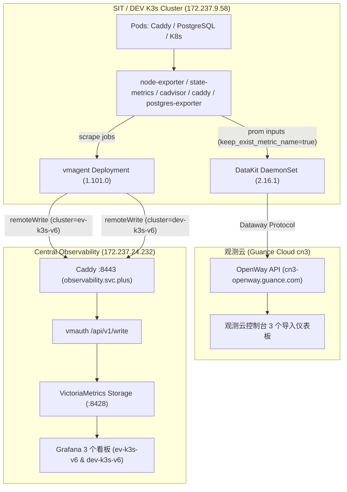

# 观测云（Guance Cloud）仪表板迁移与导入指南

本文档记录将 `https://observability.svc.plus` 权威 Grafana 面板迁移至 **观测云控制台（Guance Cloud Console）** 的规范与实操步骤，并完成 `ev-k3s-v6` / `dev-k3s-v6` 环境的无缝对接。

---

## 一、迁移面板清单

已通过官方工具 `@cloudcare/guance-front-tools` 将 Grafana 面板规范转译为观测云标准 JSON 格式：

| 原 Grafana UID | 面板名称 | 观测云 JSON 文件 | 核心指标与图表数 | 变量清单 |
| :--- | :--- | :--- | :--- | :--- |
| `postgres-unified-overview` | **PostgreSQL 统一监控概览** | [`postgres-unified-overview.json`](./postgres-unified-overview.json) | 14 个图表 (连接数、TPS、回滚率、Cache 命中率、DB 空间) | `environment`, `cluster`, `service`, `instance`, `datname` |
| `StarsL_cn_K8S` | **K8S Dashboard CN 20240513 StarsL.cn** | [`starsl-k8s-dashboard.json`](./starsl-k8s-dashboard.json) | 33 个图表 (节点状态、CPU/内存利用率、Pod/容器配额与使用量、PVC、网络) | `cluster`, `environment`, `Node`, `NameSpace`, `Container`, `Pod` |
| `fed94ifiv8h6oc` | **Caddy HTTP 与网关监控** | [`caddy-dashboard.json`](./caddy-dashboard.json) | 25 个图表 (重载状态、请求速率、响应时延分布、错误率、Upstream 健康) | `environment`, `cluster`, `service`, `instance`, `interval` |

---

## 二、观测云控制台导入步骤

### 1. 登录观测云工作空间
- 打开观测云控制台：[https://console.guance.com/](https://console.guance.com/)（或对应地域如 `https://cn3-console.guance.com/`）。
- 确认进入绑定的工作空间（Token 对应 `tkn_fffcb87e09694507b31c98b17405cc11`）。

### 2. 进入仪表板模块并导入
1. 在左侧主菜单点击 **场景 (Scenes)** -> **仪表板 (Dashboards)**。
2. 在右上角点击 **新建仪表板** 下拉菜单中的 **导入仪表板 (Import Dashboard)**。
3. 点击 **选择文件 (Upload File)**，分别上传：
   - `postgres-unified-overview.json`
   - `starsl-k8s-dashboard.json`
   - `caddy-dashboard.json`
4. 确认标题与标签（Tags），点击 **确定 (Confirm)** 保存。

### 3. 口径与变量校验
- **PromQL 引擎兼容**：面板均声明 `"datasource": "dataflux"` 与 `"qtype": "promql"`，完全复用 PromQL 表达式。
- **视图变量绑定**：变量占位符已由 Grafana 的 `${var:regex}` 规范转为观测云的 `#{var}` 语法；针对 `*`（全选）统一配置 `"starMeaning": ".*"`，避免 PromQL 正则解析错误。
- **Grafana 宏替换**：观测云 PromQL 解析器不支持 Grafana 特有宏 `$__range` 与 `$__rate_interval`，已转为动态变量 `[#{interval}]`（Caddy 看板）或标准步长 `[5m]`（Postgres/K8S 看板）。
- **指标名对齐**：DataKit 采集器启用了 `keep_exist_metric_name = true`，保留原始 `pg_*`、`caddy_*`、`kube_*`、`node_*` 与 `container_*` 指标名，与原 Grafana 查询口径 100% 一致。

---

## 三、`ev-k3s-v6` 环境双轨对接架构

为满足在既有权威源 `https://observability.svc.plus` 与观测云控制台两者都能无缝查看 `ev-k3s-v6` 指标，部署了双轨采集转发架构：

1. **观测云控制台链路**：
   - DataKit 通过 `[[inputs.prom]]` 采集 Caddy 与 PostgreSQL Exporter 指标，附带 `cluster = "ev-k3s-v6"`, `environment = "dev"`, `env = "sit"` 标签。
   - 容器与集群日志通过 DataKit containerd socket 直接推送到观测云日志检索空间。
2. **Grafana 控制台链路 (`https://observability.svc.plus`)**：
   - `observability-vmagent` 通过 Prometheus remote_write 协议将经过 relabel 过滤后的核心指标推送到 `https://observability.svc.plus/ingest/metrics/api/v1/write`。
   - 双重 URL 标签分发：同时写入 `cluster=ev-k3s-v6` 与 `cluster=dev-k3s-v6`，确保无论在 Grafana 下拉菜单中选择 `ev-k3s-v6` 还是 `dev-k3s-v6`，3 个面板均能准确渲染指标。
